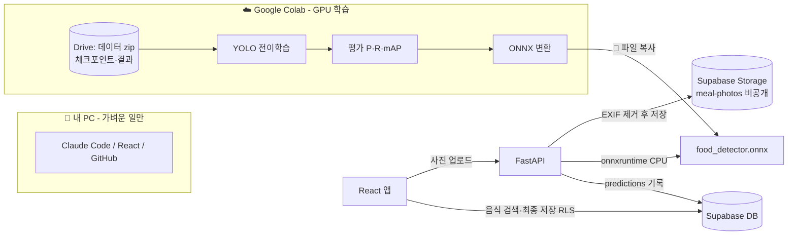
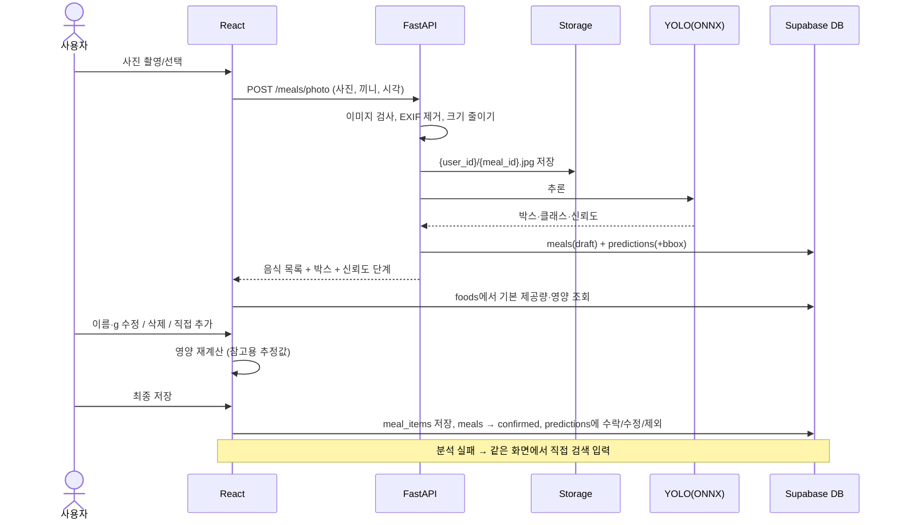

# SlimLog AI 음식 사진 분석 — YOLO 전환 설계안 (STEP 1~3)

작성일: 2026-11-04 · 발표일: 2026-12-01 · 상태: **승인 대기 (코드·DB·패키지 변경 없음)**

> **지금 상태 한 줄:** 화면·서버·DB 흐름은 이미 있고 **목업 결과**로 돌아간다. 실제 학습된 모델은 **아직 없다.**
> 이 문서의 숫자(정확도·속도)는 전부 **목표 또는 추정**이고, 실측값이 아니다.

표시 규칙: 👤 = 내가(사용자) 직접 · 🤖 = Claude Code · ☁️ = Google Colab에서

---

## 0. 먼저 결정해야 할 것 (기존 계획과 충돌 5개)

| # | 기존 계획 | 새 요청 | 내 추천 |
|---|---|---|---|
| C1 | EfficientNet-B0 **멀티라벨**(사진 전체에 "있다/없다") | YOLO **객체 탐지**(음식마다 위치 박스) | YOLO로 전환. EfficientNet 코드는 지우지 않고 P2용으로 보관 |
| C2 | 학습은 **사용자 PC**. "AI Hub 원본은 해외 서버·클라우드로 옮기지 않는다" (`ai/train/README.md`) | 학습은 **Google Colab** (구글 해외 서버) | ⚠️ **AI Hub에 Colab 사용 가능 여부 문의 필수.** 답 오기 전엔 AI Hub 데이터를 Colab에 올리지 않음 (4.2 참고) |
| C3 | 승인 2번: 화면에서 **영역(박스) 그리기 제거** | 음식별 **바운딩 박스** 반환 | 박스는 **보여주기만** 하고 편집은 안 함 (영역 편집 UI 부활 X) |
| C4 | 승인 3번 보류: **신뢰도 %는 화면에 안 보임** | 신뢰도 확인 필수 | % 대신 **3단계 표시**(높음 / 보통 / 확인 필요), 숫자는 상세에서만 |
| C5 | DB `model_versions.task`는 `multilabel`·`single`만 허용 | 탐지 모델 버전 기록 | `detection` 추가 + mAP 칸 추가 (최소 변경, 5장) |

👤 이 5개에 OK/NO만 답해 주면 됨.

---

## STEP 1. 현재 구현 상태 (읽기만 함)

| 영역 | 있는 것 | 상태 | 재활용 |
|---|---|---|---|
| 식단 기록 UI | `src/features/meal/` — 시작 → 사진 → 검토(`MealReviewPage`) → 저장. 후보 고르기·제외·직접 추가·섭취량 수정·음식 검색·직접 등록 | ✅ 동작 (목업 + 실서비스 모드) | **거의 그대로** |
| 사진 업로드 | `MealPhotoPage` → `POST /meals/photo`. 서버가 EXIF(위치정보) 제거, 1600px로 줄여 JPEG 저장 | ✅ 코드 완료, 배포 전 | 그대로 |
| AI 인식 | `server/app/recognizer.py` — ONNX 멀티라벨. 모델 파일 없으면 **고정 예시(mock)** | ⚠️ 모델 없음 → 항상 목업 | 탐지용으로 **교체** (mock 유지) |
| FastAPI | `server/app/` — 인증(JWT), 사진, 커뮤니티, 인바디, 푸시, 탈퇴. Dockerfile 있음. `onnxruntime` 이미 설치 목록에 있음 | ✅ pytest 있음, 배포 대기 | 그대로 + 인식 부분만 수정 |
| Supabase | `meals`(사진 경로·메타) + `meal_items`(음식별 g·영양 스냅숏) + `predictions`(인식 결과, 사용자 수락/수정/제외 기록) + `foods`(`ai_class` 칸 있음) + `model_versions`. Storage `meal-photos` 비공개, **본인 폴더만** 읽기 | ✅ RLS 테스트 46개 통과 | **거의 그대로** (칸 몇 개만 추가) |
| 식단 분석 | `src/features/analysis/NutritionPage.tsx` — 일평균 칼로리, 탄·단·지 | ✅ | `meal_items` 값을 쓰므로 **수정 불필요** |
| 영양 DB | `scripts/foods/import_foods.py` — 식약처 표준데이터 CSV → `foods` (빈칸은 null, 0으로 안 바꿈) | ✅ 도구 완료, 실데이터 미적재 | 그대로 |
| 학습 코드 | `ai/train/` EfficientNet 멀티라벨 + ONNX 변환 + 지표 | ⚠️ 한 번도 실제 학습 안 함 | P2 보관. 데이터 분할(그룹 분할) 아이디어 재사용 |
| 데이터 점검 | `ai/scripts/inspect_labels.py`, `ai/tools/windows/check_labels.*` | ✅ 실데이터로는 아직 안 돌림 | 그대로 → YOLO 변환기 추가 |
| 음식 20종 | 문서에 "20종"만 있고 **확정 목록은 없음** (`classes.example.json`엔 3개뿐). 목업 음식 카탈로그엔 한식 위주 40여 개 | ❌ 미확정 | 아래 3장에서 새로 정함 |

**핵심:** 기존 흐름이 "사진 → 후보 목록 → 사람이 확인 → 저장"이라 **YOLO로 바꿔도 화면은 거의 그대로**다. 바뀌는 건 "서버 안의 AI 엔진"과 "사진 위에 박스 표시" 정도.

---

## STEP 2. 기술 타당성

### 2.1 YOLO 모델 추천

> 비유: YOLO = 사진을 한 번 훑고 "여기 피자, 저기 콜라"라고 **포스트잇을 붙여주는** 모델. 멀티라벨은 "이 사진에 피자 있음"까지만 말해 줌.

**추천: Ultralytics `YOLO26n` (주력) + `YOLO11n` (비교용)**
- 라이브러리: `ultralytics` (PyPI 최신 8.4.x 확인, 2026-11-04). 실제 설치는 Colab에서, 버전은 노트북에 고정
- 둘 다 Colab에서 전이학습 → ONNX로 내보내기 → 서버는 **이미 있는 `onnxruntime`**으로 추론 (서버에 PyTorch 필요 없음)

| 기준 | YOLO26n | YOLO11n | 판단 |
|---|---|---|---|
| 여러 음식 + 박스 + 클래스 + 신뢰도 | ✅ | ✅ | 둘 다 충족 |
| CPU 추론 | NMS(겹친 박스 정리) 없이 바로 결과 → CPU에 유리하다고 공개됨 | 검증된 표준 | **실측으로 비교** |
| 크기 | n(nano) 모델 ONNX 약 10MB 안팎 (추정) | 비슷 | 무료 서버에 올라감 |
| 자료·예제 | 비교적 새 모델 | 자료 가장 많음 | 막히면 11n으로 |
| 라이선스 | **AGPL-3.0** | **AGPL-3.0** | ⚠️ 아래 |

⚠️ **라이선스(AGPL-3.0)**: 이 모델로 웹 서비스를 하면 **서버 소스코드를 공개**해야 함. 캡스톤(비영리 + GitHub 공개)이면 문제 없음. 나중에 상용화하면 Ultralytics 유료 라이선스나 Apache 계열 모델(RT-DETR 등)로 바꿔야 함 → 발표 자료에 한 줄 넣기.

s(small) 모델은 정확도↑ 속도↓. **n으로 시작, 시간 남으면 s 비교(실험 C).**

### 2.2 데이터셋 — 이게 제일 큰 위험

| 필요한 것 | 후보 | 박스 | 한 장에 여러 음식 | Colab 사용 |
|---|---|---|---|---|
| 한식 | **AI Hub 242 건강관리를 위한 음식 이미지** (승인·다운로드 가능 상태) | 확인 중 (`check_labels` 결과 대기) | 확인 중 | ⚠️ **문의 필요** |
| 한식 | AI Hub 71564 (박스 라벨, 약 23만 장 — 소개 자료 기준) | 있다고 알려짐 | 확인 필요 | ⚠️ 문의 필요 |
| 양식·패스트푸드·카페 | **Open Images V7** (피자·햄버거·감자튀김·샐러드·케이크·베이글·커피컵·파스타 등 박스 있음) | ✅ | ✅ 일부 | ✅ 라벨 CC BY 4.0, 이미지 CC BY 2.0 |
| 보조 | COCO (피자·샌드위치·케이크·도넛·컵) | ✅ | ✅ | ✅ |
| **실전 시험지** | 👤 **직접 찍은 밥상 사진 100장** + 박스 라벨링 | 직접 그림 | ✅ | ✅ 내 데이터 |

**데이터 섞을 때 함정 (중요):** Open Images 사진에 밥이 있어도 "밥" 라벨은 없음 → 모델이 "밥 = 배경"이라고 잘못 배울 수 있음. 대응: 한식/양식 클래스를 출처별로 나누고, **최종 평가는 모든 음식을 다 라벨링한 내 사진 100장**으로 함.

**라벨링 도구:** Roboflow **무료 플랜은 프로젝트가 공개**됨 → 내 밥상 사진엔 부적합. **CVAT(cvat.ai 무료)** 또는 Label Studio 추천. 둘 다 YOLO 형식 내보내기 됨. (가입 전 이용 조건 👤 확인)

### 2.3 Colab 학습 방법 ☁️

- 데이터는 zip 하나로 **Google Drive**에 → Colab에서 `/content`로 복사 후 학습 (Drive에서 직접 읽으면 느림)
- 결과 폴더(`project=`)를 **Drive로 지정** + `save_period`로 중간 저장 → 끊기면 `last.pt`로 `resume=True` 재개
- 무료 GPU(T4) 제약: 세션 최대 약 12시간, 손 놓으면 90분쯤 끊김, **하루 사용량 한도 비공개·변동**
  → 한 번에 짧게(30~50 epoch) 돌리고 이어서 재개. 막히면 Colab Pro(월 약 1만 원대, 👤 결정)
- 예상 시간: 12종 × 클래스당 300~500장, n 모델 → T4로 **1~3시간 (추정, 실측 필요)**

### 2.4 서버 배포

| 선택지 | 비용 | 장점 | 단점 |
|---|---|---|---|
| **기존 FastAPI에 그대로 탑재 (추천)** | Render·Fly 무료~월 몇천 원 | 코드 하나, Dockerfile 있음 | 무료 등급은 잠들었다 깨는 데 30초+ → 발표 직전 깨워두기 |
| Hugging Face Spaces (CPU) | 무료 | 메모리 넉넉 | 서버 2개 관리 |

### 2.5 12월 1일까지 가능한 범위 (현실 판단)

- **P0 (12종 다중 탐지 + 영양 + 수정 + 저장): 가능.** 단, **11/10까지 데이터가 확정**돼야 함
- P1 (20종): 데이터가 순조로우면 가능, 아니면 포기
- P2 (30종 + 세부 분류): **이번 일정에선 비추**
- 아메리카노 vs 카페라떼: 사진으론 구분 어려움 → **"커피" 1종으로 탐지 → 사용자가 종류 선택**

---

## STEP 3. 최종 설계

### 3.1 전체 구조



### 3.2 AI 학습 파이프라인

1. 🤖 데이터 점검 (`inspect_labels`) → 👤 결과 전달
2. 🤖 변환기: AI Hub/Open Images → **YOLO 형식**(사진별 txt: `클래스번호 x y w h`)
3. 🤖 분할: **같은 촬영 묶음은 한쪽에만** (train 70 / val 15 / test 15) → 데이터 누수 방지
4. 👤 zip을 Drive에 올림 ☁️
5. ☁️ 실험 A → B → (C), 결과는 Drive `runs/`에 자동 저장
6. ☁️ `best.pt` → ONNX + `meta.json`(클래스→food_id, 기준값, 버전)
7. 👤 두 파일을 `server/models/`에 넣기 → `/health`가 `ready`로 바뀌면 진짜 모델

### 3.3 사진 분석 순서도



### 3.4 FastAPI 엔드포인트

| 메서드 | 경로 | 변경 | 내용 |
|---|---|---|---|
| GET | `/health` | 유지 | `model_status`: ready / not_loaded / mock |
| POST | `/meals/photo` | **응답 확장** | 기존 필드 + 음식마다 `bbox`(0~1 비율 x,y,w,h), `confidence_level` |
| DELETE | `/meals/{id}` | 유지 | 사진+기록 같이 삭제 |
| GET | `/models/current` | **신규 (작음)** | 버전·클래스 목록·mAP·지연시간 (발표·화면 안내용, 실측값만) |

음식 검색·최종 저장은 지금처럼 **앱 → Supabase 직접 (RLS 보호)**. 서버 일 늘리지 않음.

응답 예시 (모양만, 값은 예시):
```json
{ "meal_id": "...", "mode": "model", "model_version": "yolo26n-food12-v1",
  "labels": [ { "pred_id": "...", "food_id": "rice", "status": "recognized",
    "score": 0.82, "threshold": 0.45, "bbox": [0.12, 0.55, 0.30, 0.28], "candidates": ["rice"] } ] }
```

### 3.5 Supabase 확장 (최소 변경, 삭제 없음)

```sql
-- 010 (초안, 실행 안 함)
alter table public.model_versions drop constraint model_versions_task_check;
alter table public.model_versions add constraint model_versions_task_check
  check (task in ('multilabel', 'single', 'detection'));
alter table public.model_versions
  add column map50 numeric(5,4), add column map50_95 numeric(5,4), add column classes jsonb;
alter table public.predictions add column bbox jsonb;  -- [x,y,w,h] 0~1, 탐지 모델만
```
- `foods.ai_class` 이미 있음 → 학습한 음식만 `true`
- AI 클래스 ↔ 음식 DB 연결: `meta.json`의 `classes`에 **food_id를 직접** 적음 (예: `rice` → `mfds-xxxx`). 연결 못 한 클래스는 학습 목록에서 뺌 → **임의 영양값 생성 없음**
- 사진 보관·삭제: 기존 정책(`docs/DB_동의_삭제정책.md`) 그대로. 모델 개선용 사용은 `photo_improve` 동의자만

### 3.6 화면 변경안 (기존 유지 + 추가)

- **사진 위에 박스 + 번호** 표시 (편집 X) → 목록의 같은 번호 음식과 연결
- 음식 줄마다 신뢰도 **3단계 배지** (C4 결정에 따름)
- 섭취량: 기본 제공량(1공기·1인분)으로 시작 + "0.5 / 1 / 1.5 / 직접 g" → 영양 즉시 재계산 (기존 기능)
- 모든 영양값 옆 "**참고용 추정값**" 문구, 상단엔 지금처럼 **목업/실제 모델 구분 배지**
- 분석 실패·0개 탐지 → "직접 검색해서 추가" 바로 안내 (기존 직접 추가 재사용)

### 3.7 음식 목록 (잠정 — 데이터 보고 확정)

| 단계 | 한식 | 양식 | 패스트푸드 | 카페 |
|---|---|---|---|---|
| **1차 12종** | 쌀밥, 김치찌개, 배추김치, 계란말이 | 피자, 파스타, 샐러드 | 햄버거, 감자튀김, 치킨 | 커피, 케이크 |
| 2차 +8 → 20 | 된장찌개, 김밥, 라면, 떡볶이 | 스테이크 | 핫도그 | 베이글, 도넛 |
| 확장 ~30 | 비빔밥, 불고기, 제육, 잡채, 미역국 … | 샌드위치 | 너겟 | 크루아상, 와플 |

목업 카탈로그(쌀밥·김치찌개·배추김치·계란말이·된장찌개 등)와 겹치는 건 그대로 food_id 재사용.

### 3.8 주차별 일정

| 주 | 기간 | 👤 내가 할 일 | 🤖 Claude Code | ☁️ Colab |
|---|---|---|---|---|
| 1 | 11/4~11/10 | 242 라벨 점검 결과 전달, **AI Hub에 Colab 문의**, 밥상 사진 100장 촬영, CVAT 가입 | 변환기·분할 스크립트, Colab 노트북, DB 010 초안 | 환경 테스트 (작은 샘플로 1 epoch) |
| 2 | 11/11~11/17 | 사진 100장 박스 라벨링, Colab 실행 버튼 누르기 | 결과 정리 스크립트 | 실험 A·B, 평가 |
| 3 | 11/18~11/24 | 화면 확인 | ONNX 탐지 추론, API 응답 확장, 박스 표시 UI, 영양 DB 연결 | (필요시) 실험 C |
| 4 | 11/25~12/1 | 서버 배포 계정, 발표 연습 | 통합 테스트, 성능표·그래프 | — |

### 3.9 위험 요소와 대응

| 위험 | 가능성 | 대응 |
|---|---|---|
| AI Hub 데이터 Colab 사용 불가 | **높음** | 한식은 내 사진 + Open Images로 축소, 양식 비중↑ / 학습만 국내 환경 검토 |
| 242에 박스·다중 음식 없음 | 중 | 71564 확인 → 안 되면 한식 클래스 수 줄이기 |
| 출처 섞기로 생기는 "라벨 누락" 문제 | 중 | 평가는 완전 라벨링한 내 사진으로, 결과에 그대로 보고 |
| Colab 무료 GPU 끊김·한도 | 중 | Drive 체크포인트 + 재개, 짧게 나눠 학습 |
| 커피 종류·찌개끼리 헷갈림 | 높음 | 상위 클래스로 묶고 사용자가 선택 |
| 무료 서버 느림·잠듦 | 중 | 발표 전 깨우기, 지연시간은 서버에서 실측 |
| 중량 추정 | 확정 | **하지 않음.** 기본 제공량 + 사용자 수정 |

### 3.10 발표용 성능 평가 계획

| 실험 | 내용 | 비고 |
|---|---|---|
| A | 사전학습 모델 그대로 (COCO) | COCO에 있는 음식(피자·케이크 등)만 측정 가능, 나머지는 "측정 불가"로 표기 |
| B | 우리 데이터로 전이학습 (26n, 11n) | **같은 분할·같은 테스트셋** |
| C | 증강·이미지 크기·s 모델 (시간 되면) | |

- 지표: Precision, Recall, mAP@50, mAP@50-95, **클래스별 표**, 사진 1장당 CPU 추론 시간(서버에서 측정)
- 테스트셋 2개: ① 데이터셋 test 15% ② **내 실제 밥상 사진** (발표에서 가장 설득력 있음)
- 결과물: 표 + 그래프(클래스별 막대, 학습 곡선, 혼동 행렬), 결과 JSON을 저장소에 저장
- **학습 안 끝났으면 "완료"라고 안 씀**, 수치는 실측만

---

## STEP 4. 구현 순서 제안 (승인 대기)

1. 🤖 `ai/detect/` 변환기 + 분할 + 테스트 (기존 코드 안 건드림)
2. 🤖 Colab 노트북 `ai/colab/train_yolo.ipynb` (설치·Drive·재개·평가·ONNX)
3. 🤖 서버: 탐지 추론 클래스 추가 (기존 멀티라벨·mock 유지, 모델 파일 종류로 자동 선택) + pytest
4. 🤖 DB 010 마이그레이션 **파일만** 작성 → 👤 SQL Editor에서 실행
5. 🤖 화면: 박스 표시 + 신뢰도 배지
6. 🤖 성능 리포트 생성 스크립트 (표·그래프)

**👤 승인 필요:** 충돌 C1~C5 결정 · 위 순서 · 1차 12종 목록 · AI Hub 문의 진행
